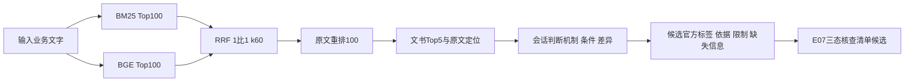

# FinRisk当前完整离线方案与增强取舍

本版把E01–E07的方法、已做实验和采用条件放在一份方案里。当前仍用用户指定的BM25:BGE=1:1；E08按用户要求暂缓。**方案完整表示路线与取舍清楚，不表示所有增强项已全量部署或全库已通过人工验收。**

## 当前可展示的主流程

全9639候选文书、65475结构化单元；官方27类保持原字典。原短文本用于检索与重排，命中21个已审scope单元时显示独立对应原文，其他单元保持现有范围。显示改动不冒称模型已用长文本计算；批准单元不批准整篇文件。0标签与“本段未见明显风险”都不等于完整业务合规。可能标签服务于召回和核查，不能反向改写源事实。

检索和原文证据包已有离线命令入口；最终判别由当前会话逐段阅读完成。E07是已保存的条件回放/提问门控模块，尚未自动接到新输入的判别输出或客户问答。需要补资料时列具体核查问题，资料实际取得后重新检索、再判断，不把本轮8个构造分支当真实答复。

证据包保存输入原话、实际Top5、命中unit及对应源区间、官方标签候选、机制直接/部分/无关关系、连续引文、主体责任、条件差异、还缺什么。高相似分和其他主体受罚均不能单独证明输入违规；有用核查资料也不自动是直接同机制正例。

## E01–E08任务对照与采用状态

|增强项/教材原步骤|实际完成|当前采用或候选|未完成/后置|
|---|---|---|---|
|E01 格式与切分 S15/S22|24单元原文范围审查，21可显示；固定排序显示与长文本索引对照|已审单元的范围返回用于V3；原短索引保留|四记忆格式、token/重叠/语义切分大网格、全库范围审核|
|E02 复杂前缀 S23–S24/S34|21有源限定背景及索引/显示受控对照；相对scope无新增帮助|不全量扩写，源与背景依赖留存|复杂自由摘要、概览/细节、主动审核收益全网格|
|E03 跨案例规则 S26–S27/S39|4有源机制卡及第三路检索，指标与原版相同|留作候选核查资料，不常开第三路|全库规则、真实反例库、深层因果统计|
|E04 高级检索 S25/S33|BM25+BGE/RRF/rerank真实全库链路；1:1/2:1同轮对照|当前按用户决定1:1；2:1历史开发结果保留|进一步融合权重、候选深度、多向量、ANN索引对照|
|E05 RAPTOR S36/M14/M27|21→4→2→1真实递归硬聚类、7源审摘要、6目录、16×3全库检索与统一判读|严格47→45/80；宽口径持平53/80，暂不启用|软聚类复现、稳定性、全库树、跨案综合任务|
|E06 GraphRAG S29/S37/M28–M29|19全文/8候选事件，7源支持；角色/事件注释，16输入后置补位控制|注释留候选；自动补位有用53→51/80，不启用|全局实体消歧、社区发现、报告和多跳任务|
|E07 原型/补信息 S38–S39/M41–M43|7机制核查，16输入64条件，33未知、31问题，8模拟条件分支|结构化缺口与提问门控候选；不宣称问题内容优于V3|特征独热/多热、log变换/标准化、事实原型聚类/稳定性、可信目标的重要性|
|E08 高级维护/多模态 S30/S40|本轮不执行，基础源保存/版本校验继续保留|用户暂缓|高级压缩/全局重组、额外媒体和模型记忆|

E01–E04的五小时历史报告曾推荐2:1，当前采用以V3及本方案的1:1为准，历史文件未改。曾见的新20文字权重开发迹象59→63/100，不能拿来替代当前已指定参数，也不能和E05的新判读直接相减。

## 本轮新增三项的效果和价值

E07：19明确记载、12明确否定、33未知；unknown不会改为否。D004没有额外利益时抑制2个下游问题，仍保留未知；D006不把合同当授权、未要求回流当已知未回流。优先级是工程顺序，不是统计重要性。8模拟补资料分支只展示条件影响，没有新检索或准确率实验。V3已有主要missing_information，因此价值是结构化与门控而非已证明问答质量提升。

E06：同文件不同行为、同名、多主体表格、管理责任和直接动作分别处理。只在原unit全部源区间落入唯一已核事件范围时标组，1个不确定组不强并；F000922前置11字符标题跨范围，仍不归组。重复占位3→0并未带来更有用Top5，不能用“事件更丰富”替代实际帮助标准。保留图供阅读时识别责任及潜在重复，默认排名不变。

E05：父摘要只导航，原文作证据。硬聚类产生混合簇，摘要有源支持却未达到核心启用的语义一致性要求；节点命中也不等于有用返回增加。严格新评原版47/80、目录/树45/80，宽核查口径三者53/80，都不支持扩树为近期主攻方向。

## 来源、数据库与表示的基本边界

原来源、候选抽取、已批准范围、检索表示、实际返回及模型判断分存，file/unit/case/behavior引用和源SHA保留。原文事实与候选可能标签分开；主体责任、不确定关系、历史适用和未取得原件不填成已证事实。摘要/机制卡/节点/图引用反向到原leaf和源区间，每个断言有支持记录。

源、文字或范围改变后，衍生节点、索引、向量、模型分数与判断绑定重新核对。相同query ID不能代替相同输入内容；本轮补齐E06复用前输入/packet/源/位置校验，16真实输入通过、改文本探针均拒绝，保存结果未改变。此要求适用于以后生成和实验。

当前资料状态是全量候选基础库和局部已审增强范围，未经全库独立人工语义确认。金额、罚款、资格类别和历史制度只按原文角色保存，不因模型标签或摘要升格为当前规则。基础回源、版本、缓存及封包检查继续执行；它们与E08高级维护不同。

## 评价怎么落地

主标准始终是“实际召回内容是否具体帮助判断输入风险”，同时记直接支持、条件/反向帮助、无关及信息缺口。固定Top5分母，保存所有失败、间接类比和同事件多文书；全文有事实但显示没事实时，不能把片段计为有用。主对照同输入/同轮/同评价者/同阈值，不能跨轮模型评分做因果比较。

本轮83新上下文配置隐藏、逐条新判读，所有正向引文与SHA通过；仍是模型评价，16输入早已曝光，非真人金标/真实Recall/27类标签准确率。宽口径另列敏感性，不覆盖新主分。需要对外演示时说明哪些判断来自输入、哪些来自直接案例、哪些仅核查类比。

## 下一步的具体优先级

1. 先拿本版主流程与上述取舍展示，保留1:1。用真正未参与调试的业务文字及人工判定标准补验风险、相反条件、信息不足三类。
2. 定向测重排与条件匹配。D013的F000699已经BM25第8并在候选100，TREE将RRF推至1却重排31；先对候选有源而末端丢失的案例作小对照，记录原模型/候选/阈值，避免继续盲目扩索引树。
3. 对具体命中缺条件/主体串接的单元扩范围审核，按unit批准，不按整文件批准。把机构违法与个人责任、合同内与合同外利益、实际代理与虚挂分别作为回归条件。
4. 有真实输入收益后再把E07三态/问答门控接进离线证据包；事件注释先解释潜在重复，不硬删补充文书。之后才决定应用接入及更大E05/E06。

本轮完成上述三个小实验及采用/暂缓记录；不是完成E05–E07所有原清单扩展。E08继续暂缓，无新增外部API或自动客户咨询。

## 结果入口

[三项实验总报告](实验总报告.md)、[E07报告](E07实验报告.md)、[E06报告](E06实验报告.md)、[E05报告](E05实验报告.md)、[最终核验](verification_final.json)。代码、源审查及配置在work/finrisk_e07_e06_e05_20261013；所有新结果在本目录，旧封包保持原字节。教材逐项依据仍见原[40步清单](../FinRisk_离线知识库重建任务清单_教材方法对应.md)。
