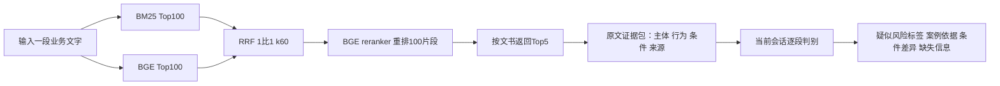

# FinRisk当前采用方案：1:1离线演示V3

本轮采用用户指定的BM25:BGE等权1:1。此前2:1的实验结果保留为后续调参候选；当前采用决定以本文件及adoption.json为准。

## 当前落地范围

知识库为现有9639份候选文书、65475个结构化单元。原短检索文本用于BM25/BGE及重排。仅命中此前21个已审核单元时，使用对应独立原文范围展示；3个主体关联歧义项及其他单元沿用原版。修显示不改原排名、重排分数或实际模型文本，不按文件名批准整篇材料。

本轮不加复杂背景前缀，不启用机制卡第三路。官方27类保持不变；有可能的标签可列候选，但推测不成为源事实。未输出标签只表示本段未见明显风险，不等于完整业务合规。

## 判断给出什么

每条输入保存原话、实际Top5、原文定位、版本及显示文本指纹。判别逐一记录五份返回材料：机制直接对应、部分相似、相反条件边界或无关；有用判断给连续逐字引文。对于疑似标签，分别列输入触发原话、可用案例、类比限制以及待补信息。

明确区分三个结果：存在风险表述；本段未见明显风险；信息不足需补核。信息不足仍可给最可能的官方风险候选，但不能把缺失条件当作已发生。高检索分、相似关键词、案例已受罚都不能独立证明输入违规；机构违法与人员责任不混写，同事件不同文书不冒称独立事件。

判别由当前会话阅读证据完成，存入model_judgments.jsonl。CLI运行真实检索和证据包导出，不自动调用风险判别API。新输入可重复这条“检索命令＋会话判读”流程；现有应用及在线Agent接入仍后置。

## 本轮验证口径

16条会话构造输入：6条风险描述、6条改变关键条件的边界描述、4条信息不足描述。三类仅是设计角色，不能作为正确答案计算准确率。与旧42输入及原3条演示无逐字重复，但未证明事件隔离，未覆盖27类全部场景，也不是人工金标。

检查流程是否完整、Top5是否有实际判断帮助、源区间和标签引用是否有效、歧义是否保留，并展示失败/间接类比。必要代码测试与字节/引用检查通过不等于全库内容正确。实际结果见本目录的演示报告和核验产物。

## 后续顺序

先用这一版本展示和收集真实业务反馈。优先修复具体检索缺口、主体串接或条件遗漏；再决定是否扩展范围返回或接到现有应用。权重调参、背景扩写、机制卡扩量、RAPTOR和GraphRAG后置。
