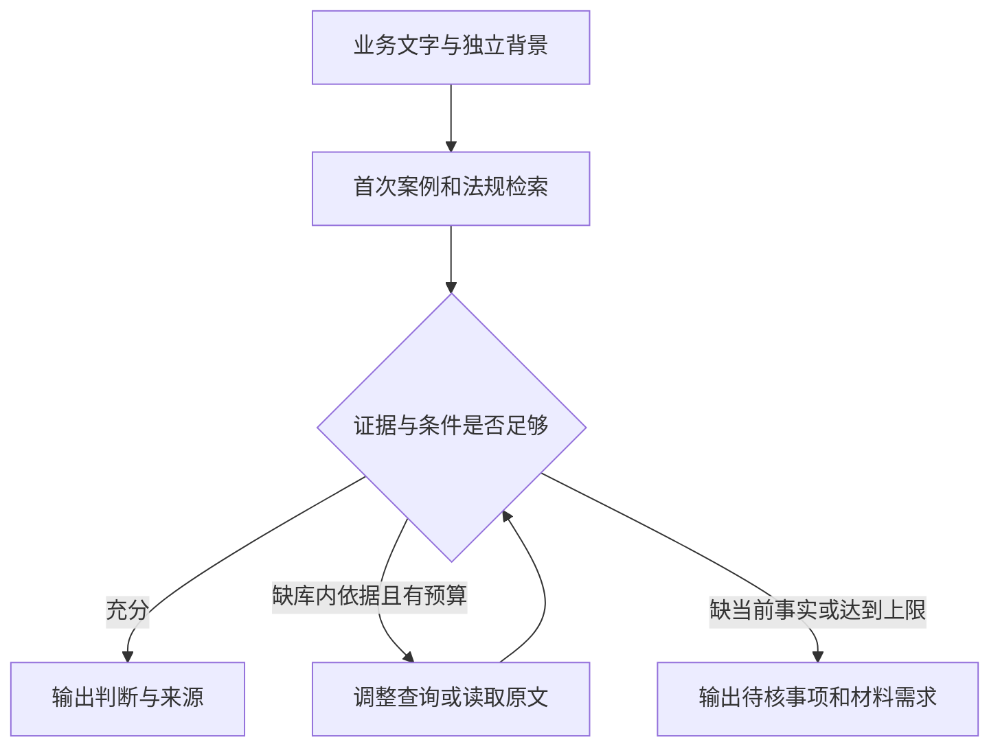

# FinRisk：Agentic RAG讨论结论与知识库职责边界

日期：2026年10月18日。用途：梳理方案选择理由，并供知识库与Agent开发协作时参考。本文记录讨论结论，不代表Agent闭环已经实现或效果已经验证。

## 1. 任务与两个窗口的分工

业务输入是一段可能含违规风险的营销、培训或其他业务文字。系统需要识别值得核查的行为，检索相关案例与法规，区分明确风险、未见明确风险、信息不足，并给出可核验依据和待补事实。

|工作范围|本知识库窗口|另一个Agentic RAG开发窗口|
|---|---|---|
|内容构建|案例、主体、行为、证据；法规原文、版本、条件、例外|消费知识库内容，不在每次查询时重建知识库|
|检索支持|检索文本、稳定ID、原文位置、机制关联、覆盖与质量说明|调用检索、选择查询、决定补查与结束|
|交接|提供明确的版本、字段说明、依赖、样例和离线验证材料|完成工具注册、流程编排、预算控制和应用接入|
|评测|提供冻结测试集、相关性参考、知识库侧指标和错误诊断|验证完整Agent的判断、证据使用、调用次数、时延与费用|

本窗口后续改进以内容与数据契约为边界。另一窗口当前代码和部署状态未在本次讨论中重新审查，不能从本窗口离线结果推断其是否已接通。

## 2. 单次LLM、固定RAG和Agentic RAG的区别

|形式|工作方式|适用条件与主要限制|
|---|---|---|
|单次LLM|输入业务文字，由模型依靠已知知识判断|简单且证据要求低时可作为基线；难保证采用指定来源和版本|
|固定流程RAG|程序检索案例、法规，把固定材料交给模型判断|流程明确、首次证据较充分时适用；材料缺口出现后缺少动态补查|
|Agentic RAG|模型根据检索反馈，选择继续查什么、读什么或结束|适合后续取证路径随材料变化的题目；增加调度错误、成本和耗时风险|

“一次调用”在这里主要指最终判别生成一次，DeepSeek重排请求另计。固定RAG也能提供引用、事实核对、条件约束和结构化结果；这些并非Agent独有。关键区别在于是否根据观察到的结果决定后续工具动作，而非调用次数多少。[Anthropic的工作流与Agent区分](https://www.anthropic.com/engineering/building-effective-agents)

## 3. 针对本任务选择Agentic RAG的合理动机

### 3.1 证据需求可能在首次检索后才明确

例如“这款产品月底停售，建议尽快办理”。历史处罚案能提示相关风险模式，但还需查明规则条件，并区分当前材料是否说明存在对应公告、产品与日期是否一致等问题。

首次材料缺适用依据时，可以继续查法规；缺当前业务事实时，应列出材料需求。案例和法规检索本身不能证明当前公司的公告是否存在。若首次材料已经充分，固定RAG或单次判别也可能给出同样好的结果。

### 3.2 已知召回缺口需要新的取证动作

全库实验追踪旧闭集99个直接支撑配对：51个未进入BM25/BGE任一路Top100单元，6个被融合Top100截断，3个在重排后未进Top20，最终保留39个。主要损失发生在重排之前。

Agent可以尝试用机制描述补查、拆分一段文字中的不同问题，或根据主体、业务环节的差异调整查询。这些动作有机会找回首轮未出现的证据；实际收益尚待验证。上述99是“题目—源文件”配对，不是99个独立事件，也不是完整全库相关性分母。[本地两层验证报告](../../2026-10-17/outputs/FinRisk_两层验证_20261017/两层验证报告.md)

### 3.3 案例、法规、当前事实应分别使用

|材料|承担的作用|不得据此推断|
|---|---|---|
|当前输入与独立背景|本次说了什么、计划或实施了什么|未附材料不等于业务未履行|
|处罚案例|历史违规模式、可比较点、关键差异|相似历史处罚不证明当前也违法|
|法规原文与条件卡|适用范围、必要条件、例外和待核事项|查到禁止条款不等于当前条件已经满足|

Agent的潜在价值是围绕具体缺口选择取证动作。判断仍须依赖证据和条件核对。

## 4. 目前证据支持到哪一步

|现有实验|实际结果|可以作出的结论|
|---|---|---|
|90题无检索／固定RAG两臂|三态正确率97.78%／96.67%，标签micro F1约0.591／0.583|本批未显示最终判断的RAG增益|
|法规首版36题|仅案例28/36；加法规28/36；加条件卡29/36|单纯增加材料未带来明显改善|
|法规快速修复回归|正确29/36→34/36；明确风险12/12保留；信息不足6/12→11/12|已见故障回归改善，非独立新题泛化结论|
|修复后再加同模型复核|36题逐题状态与初判相同|本批额外复核无主指标增益|

修复包含多项变化，不能将收益单独归因于法规、条件组合或标签规范化；本批条件组合没有改写模型建议状态。参考仍为模型银标，部分题目相关，不能作为生产准确率或独立专家结论。[修复报告](../../2026-10-17/outputs/FinRisk_法规库快速修复回归_20261017/修复实测报告.md)

因此，Agentic RAG是有针对性的待验证选择，尚未证明优于优化后的单次LLM或固定RAG。增加无新证据的重复思考或同模型互审，没有获得当前实验支持。

## 5. 已讨论的最小形式

推荐研究方向为单Agent、有限补检索；首轮证据充分则结束，缺库内依据时补查，缺当前事实或达到上限时输出待核。最多1—2轮补检索只是讨论中的起始约束，最终由另一窗口结合预算与实测确定。

本图是讨论示意，不描述另一窗口实际代码。对检索质量进行评价后选择后续动作，可参考[CRAG](https://arxiv.org/abs/2401.15884)；本文不移植其全部方法，也不将论文成绩作为本项目的效果证明。

## 6. 后续验证应回答的问题

用同一批冻结新输入比较单次LLM、固定RAG、受限Agentic RAG，记录所有实际调用、失败和成本；除质量优先比较，还应提供预算或时延接近时的比较，避免仅因投入更多调用而归因于Agent架构。

- 判断：三态准确率、风险P/R/F1、确定与候选标签、正常误报、信息不足识别。
- 证据：案例是否直接帮助判断，法规是否适用，引文是否回源及语义支持。
- 取证动作：补查是否新增有用来源、缺失依据是否补齐，重复搜索与无效调用数量。
- 效率：实际调用次数、费用、耗时和达到上限的题数。

闭集Recall、全库已知参考覆盖和池内NDCG分别报告。参考答案与qrels不得进入推理输入或知识库。Agent端到端实验由另一窗口负责；本窗口提供数据、版本和知识库侧验证支持。

## 7. 交接依据

- [2026-10-17公开精简交付](https://github.com/wzz356/finrisk-knowledge-base/tree/main/releases/2026-10-17)：案例库V2.1、法规、正式数据与实测结果。
- [2026-10-15检索工具设计](history/FinRisk_智能体化RAG检索工具设计方案_20261015.md)：历史设计参考；其中版本状态和实验数字是当日快照，不能覆盖本次最新交付或推断另一窗口当前状态。
- [本窗口下一阶段知识库建议](FinRisk_知识库下一阶段改进建议_20261018.md)。
