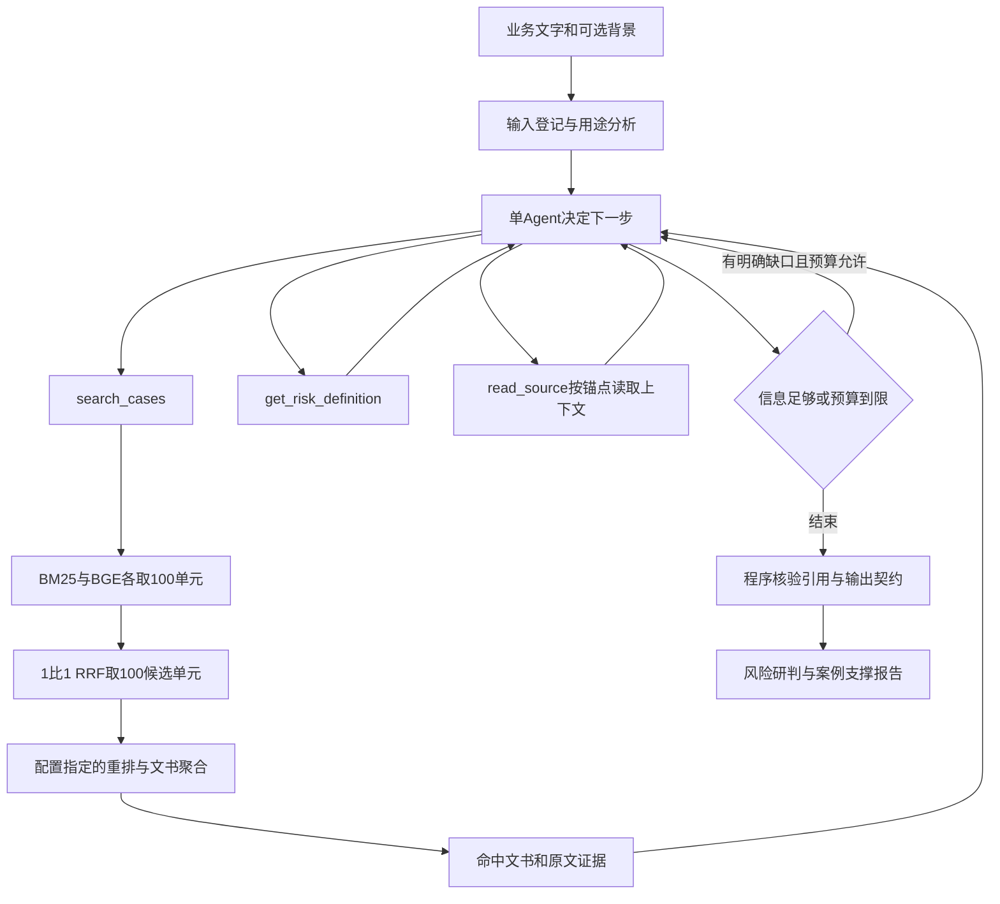

# FinRisk智能体化RAG检索工具设计方案

日期：2026年10月15日。适用项目：`C:\Users\11051\Desktop\金融比赛\复赛\FinRisk_复赛改进`。

现有BM25＋BGE、1:1 RRF和重排链路可以封装成Agent工具。推荐复用项目已有的单Agent执行器和三个只读工具，把V2检索作为新的后端配置接入。Agent负责理解材料、选择查询、按缺口补查和比较证据；检索服务负责稳定执行算法、保存版本、返回可回源的结果。

第一阶段先做离线对照，再接现有页面。模型选择、预算、知识库版本都由服务端固定；一次任务最多两轮搜索，不为每个问题启用多Agent。本文是待实施的设计，不表示新后端已经接入或Agent效果已经验证。

## 1. 业务目标与验收对象

用户输入一段可能包含违规风险的业务文字，系统需要找到能帮助判断的处罚案例，并说明当前文字与案例事实之间的相同点、关键差异和未知条件。输入也可能是合规提醒、引用他人话术、培训材料或内部流程，不能因为包含风险词就认定为当前违法行为。

最终交付应同时回答：

1. 当前材料有哪些值得核查的行为或表达，依据是输入中的哪句话？
2. 哪些历史案例能直接帮助判断，依据是原文哪一段？
3. 主体、对象、合同条件、实际行为或时间阶段是否不同？
4. 还缺哪些当前事实，为什么需要保留待核结论？

“案例直接支撑”是相关性判断，不是当前输入一定违法。处罚案例不能补足当前产品合同、材料用途、说话者身份或实际履行情况。没有检索到案例，也不能自动输出无风险。

## 2. 已有能力与真正需要接通的部分

### 2.1 两套现有能力应分开看

|能力|已核实的现状|本方案如何使用|
|---|---|---|
|重建知识库V2|9639份源文书、65475个结构化检索单元，官方27类标签，来源与稳定ID可回链|作为新检索后端的冻结输入|
|实测检索链路|BM25、BGE各最多100单元；1:1 RRF，k=60；前100单元分别做交叉编码器或DeepSeek重排；按文件最大单元分聚合|保持算法，先复现原结果再接Agent|
|新闭集评测|20题、100文书、2000对完整模型标注；3分为直接支撑|作为接口回归和受控实验开发集|
|已有Agent骨架|`src/agent_rag`、`agent_harness/src`、三工具契约、任务API、预算和原文核验已有代码|复用执行器、工具桥、输入注册、状态和报告，不另建一套Agent框架|
|Agent当前检索|`bm25-source-v1`，从官方TXT窗口做BM25；来源是OFFTXT ID，案例/行为ID为空|保留旧配置作兼容与对照，不把它当作V2混合检索|
|本地V2.1收尾修正|5份文书、8个字段的覆盖修正；尚未发布到GitHub知识库版本目录|单独版本化接入，不能用V2名称静默覆盖|

项目已有工具入口，不等于本次V2检索已接入。代码检查也不能证明部署中的真实Agent闭环已经通过验收。本轮设计不重复处理已有的状态栏、用途守卫或上下文计数修复；接入时应保留这些能力，并核对当时最新代码。

### 2.2 当前效果能支持什么决策

|封闭100文书方法|Recall@20|MRR@20|NDCG@20|Top-1|
|---|---:|---:|---:|---:|
|RRF＋BGE交叉编码器|87.83%|0.8663|0.7734|80%|
|RRF＋DeepSeek Flash|90.73%|0.9375|0.8868|90%|

全库DeepSeek实际Top20补标后，Top1为90%、MRR@20为0.95、Precision@20为65.25%。全库真实Recall仍未得到完整分母。

这些结果支持保留两种检索配置进行对照。它们没有验证Agent自主查询的收益，也不能把DeepSeek重排的成绩标到交叉编码器配置上。[本轮完整实验报告](FinRisk_可用测试集_v1_20261015/指标报告.md)

## 3. 方案选择

|方案|具体形式|适用性与代价|
|---|---|---|
|一次工具RAG|固定调用检索一次，模型据此形成报告|最快跑通，也是必要基线；不能根据结果补查|
|受控单Agent，推荐|同一个Agent按需要调用搜索、回源、字典工具；两轮内结束|能针对机制与条件缺口补查，复用现有执行器；增加模型调用，必须核算收益和延迟|
|多Agent协作|规划、检索、审核、裁定分别由Agent完成|成本与状态协调更复杂；当前缺少优于单Agent的证据，暂不进入首版|

在线问答不加入Proposer Agent—Reviewer Agent反复审核。教材中的该模式主要用于知识变更及发布审核；本方案问答工具只读，不把每次查询变成一次建库或改库任务。

## 4. 总体架构



### 4.1 职责边界

|组件|负责|边界|
|---|---|---|
|Agent|候选风险点、查询构造、信息缺口、案例适用性比较、结论草稿|不选择任意文件路径、不改索引参数、不把案例事实填入当前材料|
|检索后端|双路召回、融合、重排、文件聚合、缓存、真实调用计账|不代替Agent断言当前输入违法|
|原文服务|来源登记、原文区间、上下文续读、哈希核验|不从背景摘要或模型前缀制造原文引文|
|执行器|状态、工具白名单、统一预算、超时取消、终稿空间、轨迹|不因预算用尽把未核事项标成通过|
|结果验证器|Schema、官方标签、输入引用、来源引用、ID和版本一致性|引用存在不等于语义直接支撑；两者分别记录|

Python侧继续提供业务工具；现有Node/Pi侧继续执行Agent循环。第一版使用已有本机HTTP工具桥，无需为工具化再引入新框架。将来接其他Agent客户端时，再增加薄的MCP适配层，复用同一业务服务和契约，不复制检索逻辑。工具可以是本地函数或HTTP接口，不要求先完成MCP化。

## 5. 检索后端配置

以下两个名称是拟新增的服务端配置，当前接口尚不接受它们。原`bm25-source-v1`保持不变。

|拟新增配置|检索算法|使用位置|
|---|---|---|
|`v2-hybrid-cross-v1`|BM25＋BGE → 1:1 RRF → `bge-reranker-base`|先接通低延迟原型和Agent协议回归|
|`v2-hybrid-flash-v1`|BM25＋BGE → 1:1 RRF → `deepseek-flash`|离线质量主对照；延迟与费用通过后再用于交互|

Agent生成模型与重排模型是两个独立角色。即使Agent使用DeepSeek，检索后端也可以使用本地交叉编码器；日志必须写出两个实际模型，不能只显示“DeepSeek方案”。

### 5.1 保留已实测算法

- BM25沿用原分词、k1=1.5、b=0.75。
- BGE沿用`bge-small-zh-v1.5`、512维CLS、L2归一化及原查询指令。
- 两路各最多100单元，RRF权重1:1、k=60；前100单元进入配置指定的重排。
- 文件得分取最高单元得分，同分沿用F编号排序；单元同分保留原稳定排序。
- 不把100候选单元改称100份文件，不在接接口时顺手增加ANN、查询权重、标签硬过滤或事件去重。

首版不更换索引和切分。对候选重复、片段条件缺失等问题，先通过工具轨迹定位，再用新配置做单独实验。

### 5.2 长期驻留与批量查询

抽离实验脚本中的后端能力，形成长期驻留服务。模型、索引和文档向量在服务启动时核对并加载一次；每次请求只编码查询、检索和重排，不启动完整评测脚本、不重复加载模型。

支持一个工具调用中的多条独立查询并行，但共享GPU和外部API并发限制。初版沿用单任务准入；本地GPU重排以队列或锁控制，外部评分全服务最多8并发，不能每条查询各开8路。

### 5.3 版本绑定

每个任务准入时固定以下信息：知识库版本、源文书清单SHA、有效稿/覆盖层SHA、索引SHA、模型快照、分词和重排规则版本、工具契约与字典SHA。任务中不能热切到另一个版本。

先以已发布V2复现本次实验；随后将5份收尾修正组合成独立V2.1服务快照。V2.1的原文、有效稿、投影和引用必须一致。已知收尾报告说明排名文本未变，仍需逐单元核验后才能复用向量；不无条件重算全库，也不因正文未变就沿用失配的主体或处罚元数据。

## 6. Agent工具契约

首版继续使用现有三个工具名。`task_id`、鉴权、知识库快照、检索配置、预算及调用者权限由服务端注入，不交给模型填写。

### 6.1 search_cases：检索有判别帮助的案例

现有参数结构可保留：

|参数|约束与用途|
|---|---|
|`queries`|每次1—3条；交互原型最多3条，Flash质量配置每次最多1条|
|`queries[].text`|1—500字符；描述行为、对象和关键条件，保留否定与不确定性|
|`queries[].focus_refs`|输入注册表中的真实段落、原句及出现次数；用于说明查询从何而来|
|`queries[].risk_point_ids`|已登记的候选风险点ID；不能以新编号绕过输入绑定|
|`queries[].goal`|沿用`mechanism_search`、`condition_check`、`counter_context`|
|`top_k`|模型可见文书数量，默认5，现有上限10；先保持兼容|
|`filters`|首版保持空对象；权限和版本过滤由服务端处理，不自行添加未支持字段|

下面是参数格式示例，对应示例输入“购买这份保险，签单后额外送一张合同外购物卡。”；段落和风险点ID为示意，真实调用必须由当前任务注册表产生。它不是已执行的检索记录。

```json
{
  "queries": [
    {
      "text": "购买保险后向投保人另送合同约定外购物卡",
      "focus_refs": [
        {
          "segment_id": "S0001",
          "quote": "签单后额外送一张合同外购物卡",
          "occurrence": 1
        }
      ],
      "risk_point_ids": ["RP0001"],
      "goal": "mechanism_search"
    }
  ],
  "top_k": 5,
  "filters": {}
}
```

关键词中的官方标签只能作为可选检索表达或排序线索。不能以模型预判标签作硬过滤，因为标签本身是候选、可能漏标；也不能为提高命中率删掉“真实停售”“合同内给付”“不是存款”等关键条件。

#### 返回内容

保留现有`status/data/meta/error`外壳，拟新增兼容的`finrisk-tools/1.1`契约。Node、Python和工具声明同时升级；旧工具结果仍按旧契约读取，不能只在后端悄悄加字段。

每条查询至少返回：

- 实际执行状态、查询ID、关联风险点、是否完整和是否缩减展示。
- 按文书去重的候选：F编号、来源ID、标题、名次、分数类型、实际检索配置、候选审核状态。
- 命中的单元ID；对应的案件/行为ID保留集合，不能把多主体合并成单个已核定案例。
- 原文证据列表：证据ID、来源ID、文本版本与SHA、零基半开区间、逐字引文、可继续读取标记。
- 单元或主体归属歧义、源质量缺口、是否存在更完整上下文；未知项保留。

`meta`记录snapshot/index/profile、BM25/BGE/RRF/rerank各阶段状态、实际候选单元数、候选文书数、耗时、缓存、外部请求数及费用账本引用。DeepSeek分数是排序分数，不是违规概率或3分参考标签。

#### 工具输出与评测排名分开

工具默认只给Agent前5份，避免一次塞入20份全文。服务端仍保存完整候选排序及前20文书，供离线指标计算；这不是让模型多看未返回的证据。原有约5900字符的候选缩减逻辑应升级为“保留完整短引文、丢弃整条低位候选并明确标记”，同时受真实模型上下文计数约束。

模型看见5份、审计保存20份、实际核读3份是三个不同范围，日志和指标必须分别统计。模型未见或未核读的文件不能冒充终稿已核验支撑。

### 6.2 read_source：沿命中位置读原文

沿用`source_id`、`anchor_evidence_id`或`cursor`、`max_chars`及`has_more/next_cursor`。锚点与游标互斥；首轮建议读取1000—2000字符窗口，接口最大4800字符，并受剩余上下文与预算限制。

主要用途是补回被切分丢掉的主体、否定、申辩、真实合同条件和处罚归属。超过窗口的长事实段明确标记并续读，不把窗口不足记为条件不存在。

必须解决V2与旧来源快照的兼容：旧快照使用OFFTXT来源ID，V2使用FRV2来源ID和F编号。建立显式映射并核对全文SHA；同名文件、相同F编号或相似标题都不足以证明原文相同。无法确认的来源拒绝绑定，不能返回`source_verified=true`。

V2单元可能由多处原文及条件片段组合而成。应逐个源区间注册证据，返回多个连续引文；不能给拼接后的文字制造一个假的连续区间。模型背景前缀另存，不作为原文引文。坐标按Unicode code point处理，沿用现有Python/Node对emoji和重复引文的定位约定。

### 6.3 get_risk_definition：读取官方标签口径

继续只接受官方27标签中的名称，返回字典版本、定义和已有解释层的来源/审核状态。它帮助统一名称、理解需要核查的条件，不单独决定当前风险。

“风险机制”可以比标签更细，例如代接回访、隐瞒退损、虚构停售；不需要为每个机制创造第28个标签。暂时无法归入官方标签的观察应保留并标待分类，不能通过随意套“其他”冒充分类准确。

### 6.4 其他能力放在哪里

原文引用核验继续由现有内部验证接口和结果验证器执行，不再让Agent反复调用一个独立Reviewer。初版不增加SQL执行、任意文件读取、联网找法、改库、删除或发布工具。来源白名单和权限检查在服务端执行，检索文书中的指令性文字仅作材料。

## 7. 单Agent如何迭代

### 7.1 第一轮

1. 登记输入原句与可选背景，识别材料用途和候选机制。未知用途保留未知，不凭收益或赠礼字眼补成对外营销。
2. 选择最需要案例支撑的1—3个风险点，构造机制查询。首版最多保留3个重点检索目标；更多目标在报告中显式列未覆盖，不静默丢弃。
3. 调用`search_cases`。查看结果与当前输入的关系，优先回读能覆盖不同风险点的来源。
4. 如标签口径确有需要，调用一次字典工具批量读取相关定义；不逐标签反复查询同一静态内容。

### 7.2 什么时候补查

第二轮必须指向具体缺口，并带回同一个风险点及输入引用：

|观察|允许的下一步|
|---|---|
|只命中“财务不真实”，没有虚列会议费操作|补查“虚列会议费、培训费套资及用途”，仍保留当前原句|
|片段说“隐瞒退保损失”，不清楚销售还是回访阶段|先回读上下文；仍不清楚才以“电话回访未确认退保损失”补查|
|案例有保险/存款比较，但不清楚是否片面|回读比较条件；补查“混淆保险与银行产品/片面比较”，不能自动补遗漏费用|
|当前输入为合规提醒或本人签名，案例为违规行为|核查行为/对象是否有关键差异，形成边界对照；不是寻找更多同词处罚来证明当前违法|
|结果缺某一独立机制|对该机制补查；不为已经充分的风险点再搜索一遍|
|缺当前合同、用途或实际操作事实|记为当前事实待核；历史案例无法补足，停止无意义搜索|

### 7.3 停止条件

满足任一条件即结束工具循环，转入有保留项的报告生成：

- 每个重点风险点已有可回源、与机制和条件相符的参考，关键差异已说明。
- 已取得部分参考，但缺的是当前材料事实，继续搜案例不能解决。
- 连续两次同一目标没有新增可用证据或新增可解释差异。
- 达到两轮搜索、工具/模型/外部评分/费用/上下文/时限上限。
- 工具或模型失败，剩余预算不足以完成可靠补查。

“工具执行成功”“引文原样存在”“案例语义支撑”“当前风险成立”分别记录。`completed`只表示处理范围执行完毕，不代表所有事实已知；关键比较未完成则`partial`，语义未评则`not_assessed`。沿用项目现有的用途、insurance_product和contract_outside未知守卫。

## 8. 多查询结果如何排序，如何保持评测可解释

同一查询内部仍按原BM25/BGE 1:1 RRF和原重排排序。不同查询的交叉编码器logit或DeepSeek分数不能直接放在一起取最大，不能把改写后的检索分数当成对原输入的等价分数。

首版采用两层输出：

1. **按风险点保留查询结果**：Agent用于判断，每份来源记录由哪条查询、哪个风险点发现。查询之间按F编号去重展示，同时保留多个支持片段。
2. **需要单一Top20时统一重排**：收集所有实际查询的候选单元，去重；以各查询RRF原名次交错补位构造最多100单元的联合池，先保证每个查询至少一个候选，再按原查询顺序轮流取下一名，已选单元跳过。随后以原始完整业务输入和同一重排配置重新评分，按F最大单元分输出前20。

第二步是拟新增的可测策略，不属于已完成实验；它需要额外重排预算。交错顺序和输入顺序写入日志，不按参考答案挑候选。固定RAG与Agent比较时使用同一联合池构造/最终重排规则；只有Agent可改变查询和决定第二轮。

Flash质量试跑若没有为第二步单独预留预算，则只报告按风险点的支撑率、实际帮助和成本，不输出一个随意拼接的“Agent Recall@20”。需要比较Recall的离线实验应显式开启该最终统一评分，至多再评100单元。

## 9. 调用预算与低延迟设计

以下是拟采用的首版上限，不是实测时延或费用承诺。每个新任务配置生成独立SHA；真实收费试跑需单独设置有效费用上限，不自动继承此前重排实验的2美元预算。

|限制|交叉编码器交互原型|Flash离线质量配置|
|---|---:|---:|
|Agent模型请求总数，含修复|6|6|
|搜索调用，含重试|2|2|
|每次查询数|最多3|最多1|
|后端查询尝试总数|6|2|
|全部工具动作，含读源/字典/重试|8|8|
|常规读源预算|最多3次；余下明确待核|最多3次；余下明确待核|
|工具可见文书数|默认5、最多10|默认5、最多10|
|任务时限起点|沿用90秒上限，先测P50/P95|拟270秒上限，先测P50/P95|
|模型单请求超时|30秒且受剩余时间约束|30秒且受剩余时间约束|
|检索工具请求超时|沿用10秒，要求模型预热|拟180秒且受剩余时间约束|
|外部重排最大并发|0|全服务8|
|外部重排HTTP尝试上限|0|普通流程240；加最终统一评分时360|
|模型格式修复|最多1次，计入6次请求|最多1次，计入6次请求|
|上下文与任务token限制|保留服务16k、任务60k及1024安全余量|同左，重排请求另计账|

8个工具动作覆盖两次搜索、三次读源、一次字典及最多两个受限重试。没有必要的字典或重试可不使用，但不因此自动增加搜索上限。终稿请求必须预留；不能把所有模型次数和上下文都耗在找案例上。

Flash普通最多200个不同评分输入，余下40次是有限失败重试预算；最终统一评分最多再加100个输入及20次重试预留，总HTTP上限360。每对最多补试1次，并同时受总请求、费用和时间限制。实际缺评分要报不完整，不给0分冒充完成。

重排请求的token、美元和重试不受“Agent最多6次模型请求”覆盖，必须另记并纳入任务总费用。模型网关、Python重排服务、缓存和读源共享任务标识及取消信号；Node超时后不得继续排队发出数百个API请求。

现有离线3877对评分使用8并发约19分钟，仅能估计该批吞吐，不能保证在线每次搜索耗时。先以本地交叉编码器验证工具和Agent，再决定Flash是否满足交互目标。并行查询属于同一个Agent的一次批量工具动作，不等于多个Agent互审。

缓存绑定原查询文字、快照/索引/模型/重排提示/字典/参数版本及授权范围。可以复用相同片段评分，不能跨查询、跨版本或把旧标签当新判断。缓存命中照样计工具动作，后端实请求和命中数分别记录。

## 10. 错误处理与证据边界

|情况|行为|
|---|---|
|成功但没有结果|`empty`；可在预算内改写一次，不显示无风险|
|部分查询失败|每条保留状态，总体`partial`；成功查询不抹掉失败|
|ND部分评分缺失|保持不完整；实验不补0、不静默当交叉编码器结果|
|允许生产降级|只能由服务端预先配置，写出requested/effective profile及降级原因；不记成ND完整成绩|
|索引/源SHA不匹配|停止该来源或配置，明确版本错误，不继续标已核验|
|上下文不足|减少候选或按锚点读短完整窗口；保留否定和条件，标截断，不粗暴截掉关键句|
|引用找不到或跨来源|拒绝作为支持；至多一次受限修复，仍失败则部分报告|
|来源归属有歧义|原样标未知，回读主体段；不从同文书共现推定个人实施全部行为|
|内容含指令|按外部证据处理，不改变系统规则或触发写操作|

来源哈希通过只证明字节与冻结来源一致；当前TXT未逐份与PDF核对，不能标“原件已全部核验”。候选卡、模型前缀及推断标签不是原文事实，也不是正式批准范围。

## 11. 最终报告结构

沿用`finrisk-report`已有主要判断：`suspected`、`no_clear_risk`、`review_required`，以及任务`completed/partial`。扩展字段需要同步Node/Python Schema和页面，不能仅在自然语言中约定。

|报告内容|应包含的信息|
|---|---|
|材料与用途|输入版本、用途及其引用来源；推断与用户明确提供分开|
|每个风险点|对应输入原句、疑似官方标签、机制解释及当前判断|
|标签条件|已满足、明确不满足、未知分别列出；不增设字典之外的必需条件|
|案例参照|F编号、源ID、原文、主体/行为角色、与当前相同点和关键差异|
|帮助程度|直接、部分或仅主题；理由与缺失点，不用排序分替代|
|当前未知|合同、材料用途、实际行为等缺口；案例不能补足|
|执行状态|查询/案例待核项、停止原因、实际模型和检索配置、耗时/用量/费用|

UI只展示“理解材料—查找案例—查看原文—补充核查—形成结论”等用户能理解的进展，以及待核原因、来源和跳转。内部profile、HTTP重试和token审计放详情页或日志，不塞进普通用户操作流。

轨迹保存简短行动目的、工具参数、工具回执、证据ID和最终判断依据；不要求输出模型完整内心思考。轮询进度只读，不产生新模型调用；重启后保留旧结果和中断状态，不自动恢复收费任务。

## 12. 一条业务输入的示例流程

示例输入：“顾问向客户介绍分红保单，承诺额外分红每年最低6%，市场不好公司也补足；签单后还可以另领合同没有约定的购物卡。”

这只是拟演示输入，不是新增测试结果。

1. Agent登记“最低6%及补足”和“合同外购物卡”两个风险点，保留顾问面向客户的明确用途依据。
2. 交叉编码器配置允许一次批量查两条机制；Flash配置先查一个重点目标，第二轮预算留给另一个目标或真实缺口，报告未覆盖项。
3. 可用参考包括F001827关于“不确定分红却承诺最低6%”的事实，以及F000495关于向投保人赠送合同外加油卡的事实。是否实际召回，以新工具返回为准，不在设计中预写成Agent已经命中。
4. 按命中锚点读取原文：核对分红是不确定收益；加油卡受益者是投保人；区分机构处罚和个人主管责任。
5. 若只找到给渠道工作人员发奖励的案例，不能当客户赠礼直接证据，应补查客户合同外利益或明确仅部分帮助。
6. 报告分别说明机制及适用差异，不从历史处罚推断当前罚款金额、产品合同全貌或已经实施的事实。当前例已明示合同外；真实输入未明示时保留未知。

## 13. 如何证明Agent化有用

### 13.1 三类对照不能混用

|对照臂|做法|回答的问题|
|---|---|---|
|B0 原检索回放|原20题文字直接检索，保持原索引/候选/模型/聚合|工具封装是否改变原结果；应逐题复现当前冻结成绩|
|B1 固定RAG|沿用现有fixed_rag的风险点分析、脚本机制查询和固定回源计划；同一模型/版本/预算上限|固定编排能做到什么|
|B2 受控Agent|同B1分析与报告协议，Agent自行选工具、调整查询及决定是否第二轮|自主决策是否改善支撑，代价多大|

B0是接口等价回归，不是Agent能力对照。现有fixed_rag会根据风险点生成机制查询，与B0原文字直搜不同；不能把它的成绩直接与当前90.73%相减后归因于Agent。

B1/B2用相同候选合并及最终统一重排规则、同一模型提示与知识库；实际资源使用可能不同，报告质量与成本同时变化，不宣称所有比较都天然等成本。两个检索profile分别比较，先固定一个profile，不能同时换Agent、检索模型和知识库再归因。

### 13.2 实验顺序

1. **零收费接口回放**：以已冻结向量/交叉编码器和已存Flash评分回放B0，核对两范围五阶段原排名；Flash缓存回放明确标`replay`，不当作新API实跑。
2. **6题开发试跑**：优先KBT004、005、008、014、017、020，覆盖边界、阶段差异、内部流程及精确机制。先用交叉编码器，确认真实search→read→final闭环与预算计账；这6题不是独立最终测试。
3. **20题配对实验**：B1/B2在100封闭文书上跑，统一输出前20；仅在候选合并及最终评分预算启用时比较四指标。全部参考在模型上下文之外。
4. **全库补充**：保存真实Top20并对新配对补标，再报Top1、MRR、Precision和风险点支撑率；已知参考覆盖另报，不叫真全库Recall。
5. **新输入确认**：采用10条未参与开发的业务输入，含用途未知、提醒引用、混合风险及合同边界。先独立标出输入风险条件/范围，并在固定100文书中完整标注相关性，冻结后再运行。否则只能测检索，不能报告风险判别准确率。

20题已经被观察并用于问题诊断，继续调参后属于开发/回归集；“未见新输入”是独立验证要求，不通过随机改写原题伪造独立性。

### 13.3 指标和通过条件

|层面|指标或检查|初版通过条件|
|---|---|---|
|后端等价|B0逐题候选ID/分数/文件排名；浮点允许明确数值误差|同配置ID及稳定顺序一致；有近似差异先定位，不据指标近似就放过|
|检索质量|闭集Recall@5/10/20、MRR@20、二值NDCG@5/10/20、Top1|统一3分门槛和100文书完整分母；不使用未评补0|
|工具与引用|合法参数、字典版本、原文区间、SHA、task/snapshot绑定|测试中的无效引用/跨任务/版本篡改全部被拒绝；不把格式通过称语义通过|
|Agent增益|每风险点至少一条直接参考的支撑率；缺口解决；首次已足够是否停止|用配对结果列净改善/退步题，核对新增证据是否真直接|
|边界准确性|提醒、他人引文、合法条件、未知用途、内部行为|不补当前事实，不把反面处罚案例直接当当前违法证明|
|资源|P50/P95、模型/工具/后端/物理HTTP次数、token/实际费用、缓存、超时|每条可核算，超预算停止且无后台继续出网；mock/replay/live分开|

小样本开发的实用门槛：B2较B1至少新增2道有完整直接支撑的题，原本有支撑变无支撑不超过1道，无新增确认的当前事实捏造或无效引用，并满足预先固定的时限与费用上限，才扩大试跑。该门槛是项目工程取舍，不是统计显著性或教材保证。四指标、退步题和成本即使未过门槛也完整报告；若B1已足够，保留固定RAG作为简单输入默认。

当前测试集只有文书相关性参考，没有全部输入风险标签/条件的人审金标；本阶段不能据它计算风险判别准确率、标签F1或法律结论正确率。

## 14. 分阶段落地任务

以下为后续实施清单，本轮没有改代码。

|阶段|要做的动作|主要文件，均相对项目根目录|验收产物|
|---|---|---|---|
|P0 版本与基线|冻结V2、模型、字典；登记V2.1为独立候选服务版本；核对现有Agent代码状态|`configs/agent_rag/`，新`configs/agent_rag/retrieval-profiles.json`|版本与依赖清单、B0运行配置|
|P1 后端服务|从已核验实验抽出驻留式检索、缓存和两种重排适配，保留CLI基准|新`src/agent_rag/v2_backend.py`、`src/agent_rag/rerank_backend.py`|B0交叉编码器实跑/Flash回放等价记录|
|P2 来源适配|加载V2源清单和F映射，注册连续证据，支持多span、锚点回源及条件/角色警告|新`src/agent_rag/v2_snapshot.py`；修改`src/agent_rag/tools.py`|来源/ID/SHA/Unicode和复合片段测试|
|P3 契约与预算|注册新profile，双侧契约升级，按阶段写状态；重排与Agent统一取消/费用边界|`contracts/agent_rag/`、`src/agent_rag/task_service.py`、`src/agent_rag/router.py`、`agent_harness/src/tool_bridge.ts`、`budget.ts`、`trial_budget.ts`|mock边界测试、费用/超时/缓存轨迹|
|P4 有限Agent循环|复用用途分析/未知守卫，限制两轮，按真实缺口补查；保存分风险点结果与可选最终统一排名|`agent_harness/src/runner.ts`、`state.ts`、`retrieval_plan.ts`、`context_builder.ts`及提示配置|6题真实工具闭环与错误去向|
|P5 对照评估|B1/B2同条件配对，20题闭集和全库Top20补标，最后新10输入确认|新独立实验目录；复用当前`evaluate.py`|四指标、帮助、成本、失败及新输入报告|
|P6 页面与交付|沿用现有页面，仅增加新profile实际后端展示和案例回源；独立冻结、恢复、回退|`src/web/static/agent-rag.html`、相关已有状态组件及运行文档|可展示入口、版本、回退与使用限制|

精确的代码改动与测试位置应在执行时按当时代码核对；不复制旧实验目录为线上依赖。先做P0—P3得到稳定可调用工具，再做P4—P5证明Agent有增益。工具可独立交付给固定RAG，不以整个Agent上线作为工具完成前提。

建议排期采用两个工作日的阶段目标：第一天完成版本、后端、原文工具和零收费等价回放；第二天争取完成6题闭环及20题对照。当前Agent在其他修复中的真实准入、GPU服务化和Flash时延都可能影响排期，不能将两天当保证。若时间不足，交付工具＋固定RAG演示＋Agent受控样例，保留未完成项，不牺牲证据绑定或声称全量验收。

## 15. 对应教材第三章的方法

页码为书内页码，不是PDF阅读器页码。下表中轮次数、预算和文件结构是本项目工程设计。

|教材方法|位置|本方案对应|
|---|---|---|
|混合检索与精细重排|3.2，第82—87页|复用BM25/BGE/RRF及两种重排，不把Agent规划当检索器替代品|
|来源、知识、派生索引分层与版本|3.3.3，第92—93页|冻结快照、源SHA、有效稿/索引一致，读工具不改库|
|qualification与冲突保留|3.3.3，第93页|主体、用途、合同、阶段与时间差异；当前未知不由历史案例补齐|
|检索工具化、ReAct行动观察|3.3.4，第93—94页|Agent通过search_cases/read_source按缺口行动，并判断何时结束|
|来源与指令分离|3.3.4，第94页|工具返回外部证据标记、权限下推、只读白名单|
|工具层与可切换后端|图3-13，第95页|旧BM25、V2交叉编码器和Flash各自固定profile，共用工具契约|
|简单问题一次检索，复杂问题分解与补检索|实验3-8，第95页|按机制批量查询、关键缺口第二轮；不要求所有题多轮|
|固定RAG与Agent消融|实验3-8，第95页|区分B0等价回归、B1固定编排与B2自主工具选择|
|分块背景与上下文感知检索|3.3.5，第96—98页|前缀与原文分开；回源补足关键条件；接工具时不另造未经验证前缀|

RAPTOR、完整GraphRAG、E08和知识自动写回不作为本次工具化前置。保留现有研究产物，只有出现当前工具无法解决且可复现的需求时才扩大范围。

## 16. 依据与复核入口

- [教材第三章学习笔记](第三章_知识库构建与智能体化RAG学习笔记.md)：3.3.4与本地第三章提取正文已对照。
- [20题完整实验报告](FinRisk_可用测试集_v1_20261015/指标报告.md)、[检索实际配置](FinRisk_可用测试集_v1_20261015/retrieval_config.json)、[测试集使用说明](FinRisk_可用测试集_v1_20261015/README.md)。
- [V2.1版本与使用边界](FinRisk_基础快速收尾_20261013/version.json)。
- 现有项目：`src/agent_rag/tools.py`、`retrieval.py`、`knowledge_snapshot.py`、`contracts.py`、`task_service.py`、`router.py`；`contracts/agent_rag/tool-parameters.schema.json`、`final-report.schema.json`；`agent_harness/src/runner.ts`、`deepseek_gateway.ts`及预算/上下文组件；`configs/agent_rag/mock-baseline.json`、`live-deepseek-flash.json`。它们是本次读取时的代码现状，不是新功能交付记录。
- [DeepSeek官方Tool Calls文档](https://api-docs.deepseek.com/guides/tool_calls/)：当前示例支持deepseek-flash工具调用。首版沿用项目既有Pi工具桥/网关；不因接口支持就假设业务闭环已通过。可选strict模式是beta，支持的Schema有约束，不能直接透传完整Draft202012业务契约；业务校验仍在本地。

本轮交付为设计方案。实施后才可报告新profile可用、真实Agent闭环通过或质量提升；本轮不运行模型、不启用新收费、不修改应用默认、不自动上传此文档。
